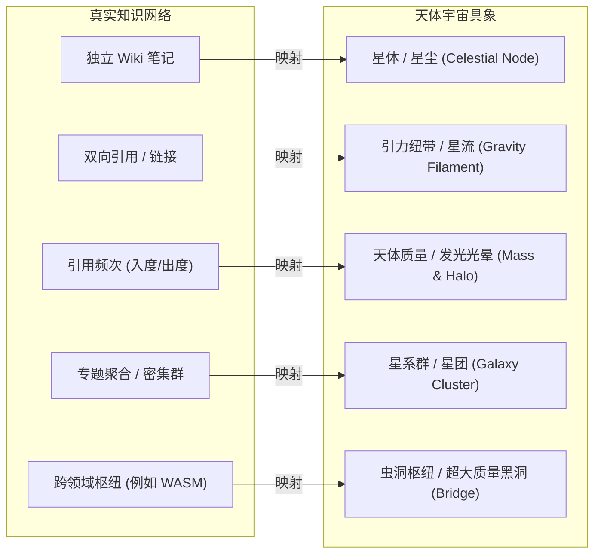
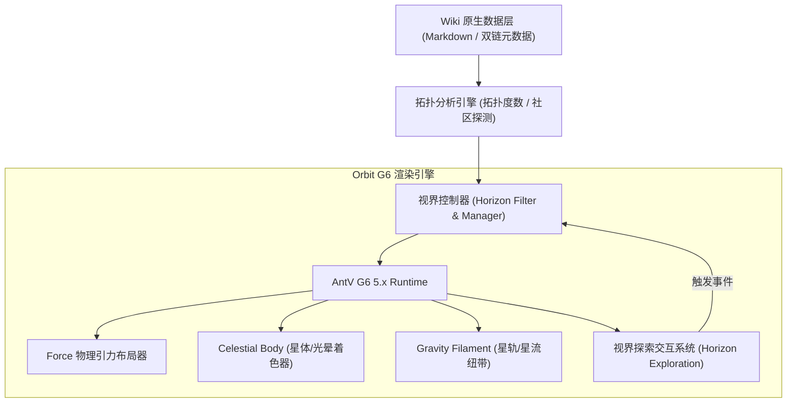

# Orbit 天体体系知识网络（Celestial Knowledge Graph）技术与开发规范

> **版本**: 1.0.0  
> **技术栈**: Vue 3 (Composition API) + AntV G6 v5.x + TypeScript + Vite  
> **定位**: 去中心化、涌现式天体引力知识图谱引擎

---

## 1. 设计愿景与概念映射体系

传统知识图谱或笔记网络往往采用预设的层级树状图（Tree）或固定同心圆（Radial），这割裂了知识之间网状交织的真实形态。
Orbit 采用**宇宙天体动力学（Celestial Dynamics）**作为核心抽象：**所有知识碎片生而平等，结构的中心性不是人工指定的，而是通过双向引力网络自然涌现的**。



### 1.1 核心要素对照表

| 概念 | 真实知识世界的对应 | 宇宙网络中的天体具象 | 规则与数学模型 |
| :--- | :--- | :--- | :--- |
| **引力节点 (Node)** | 每一个独立的 Wiki 页面或知识碎片 | 星体 / 星尘 (Celestial Body) | 零先验等级；所有节点初始具有相同势能，由拓扑关系决定演化。 |
| **引力连线 (Edge)** | 文档间的双链或引用关系 | 宇宙引力纽带 / 星流 (Gravity Filament) | $A \leftrightarrow B$ 产生拉扯弹簧引力，流量/强度影响连线光芒与粒子密度。 |
| **引力质量 (Mass / Degree)** | 入度与出度（总引用频次） | 天体物理质量、体积与光晕半径 | 自然涌现的局部重力源。度数越大，体积越大、引力势能越深、Halo 越浓。 |
| **星系群 (Cluster)** | 专题笔记群（如“前端渲染引擎”） | 星团 / 星系岛屿 (Galaxy Group) | 基于 Louvain 社区发现算法，结合节点电荷斥力与边张力聚集成团。 |
| **桥梁节点 (Bridge Node)** | 跨学科核心枢纽（如 WebAssembly） | 虫洞中继 / 超大质量黑洞 | 介数中心度（Betweenness Centrality）高，跨星系引力平衡点。 |

---

## 2. 数学与动力学算法模型

### 2.1 节点尺寸与光晕的涌现计算 (Emergent Metrics)

在数据预处理阶段，禁止写死样式属性，必须基于拓扑图的全局度数（Degree）与介数中心度（Betweenness）进行对数归一化映射：

$$R_{\text{node}} = \text{clamp}\left(12,\, 60,\, \log_2(k + 1) \times 16\right)$$

$$\alpha_{\text{halo}} = \text{clamp}\left(0.15,\, 0.8,\, 0.15 + k \times 0.05\right)$$

- $k = k_{\text{in}} + k_{\text{out}}$ 为节点的总度数（引用数 + 被引用数）。
- 对数增长保证了“高频枢纽节点不会无限膨胀，边缘星尘节点不至于肉眼不可见”。
- 光晕透明度 $\alpha_{\text{halo}}$ 与质量直接挂钩，高密节点自带强烈聚光引力场。

```typescript
export interface CelestialMetrics {
  degree: number;
  size: number;
  haloAlpha: number;
  mass: number;
  isBridge: boolean;
}

export function computeCelestialMetrics(nodeId: string, degree: number, isBridge = false): CelestialMetrics {
  const size = Math.min(60, Math.max(12, Math.log2(degree + 1) * 16));
  const haloAlpha = Math.min(0.8, 0.15 + degree * 0.05);
  // 物理质量直接影响 Force 布局中的排斥半径与引力衰减
  const mass = Math.max(1, Math.sqrt(degree + 1) * 2);

  return { degree, size, haloAlpha, mass, isBridge };
}
```

### 2.2 力导向引力动力学配置

不再使用刚性静态坐标，采用基于物理模拟的 `d3-force` / `fruchterman`：

- **节点斥力（多极电荷斥力）**: 防止星体重叠；大质量星体拥有更大斥力范围，为卫星星尘让出引力轨道空间。
- **连线引力（Hooke's 弹簧引力）**: 引用关系越紧密的星群，连接刚度（Stiffness）越高。
- **中心重力（Centering Force）**: 微弱的全局向心力，防止离散星尘漂移至无限远。

$$\vec{F}_{\text{total}} = \sum \vec{F}_{\text{repulsion}} + \sum \vec{F}_{\text{spring}} + \vec{F}_{\text{center}}$$

---

## 3. 架构设计与 AntV G6 5.x 落地规格

### 3.1 总体技术架构



### 3.2 节点与边的数据规范 (Data Schema)

```typescript
export interface CelestialNodeData {
  id: string;
  data: {
    title: string;
    summary?: string;
    clusterId?: string;      // 所属星系群
    degree: number;          // 度数
    betweenness?: number;    // 介数中心度 (枢纽评级)
    depth: number;           // 距当前探索焦点的引力层级
    isDiscovered: boolean;   // 是否在当前视界中已点亮
    metrics: CelestialMetrics;
  };
}

export interface CelestialEdgeData {
  source: string;
  target: string;
  data?: {
    weight: number;          // 引用强度
    filamentType: 'orbital' | 'interstellar'; // 本地星系内轨 / 跨星系星流
  };
}
```

---

## 4. 视界展开（Horizon Exploration）交互机制

摒弃传统文件树的“父子折叠”，采用宇宙空间物理学的**“视界探测展开”**：

```mermaid
stateDiagram-v2
    [*] --> MacroGalaxy : 默认启动

    state MacroGalaxy {
        [*] --> FilterBackbone
        FilterBackbone : 过滤显示 Degree >= 阈值的骨干星体
        FilterBackbone : 卫星微尘处于暗物质隐藏态 (Hidden / Opacity: 0)
    }

    MacroGalaxy --> PulseFocus : 点击高质天体
    
    state PulseFocus {
        [*] --> TriggerExpansion
        TriggerExpansion : 计算一阶与二阶相连卫星节点
        TriggerExpansion : 节点从母星坐标以初速度弹射扩散
        TriggerExpansion : 星轨连线伴随引力波逐级点亮
    }

    PulseFocus --> MicroSystem : 展开完成
    
    state MicroSystem {
        MicroSystem : 焦点星体激活轨道光环 (Orbit Ring)
        MicroSystem : 卫星星尘环绕母星完成力导向再平衡
    }

    MicroSystem --> MacroGalaxy : 再次点击母星 (引力坍缩收回)
    MicroSystem --> PulseFocus : 点击新的星体 (转移视界探索)
```

### 4.1 详细交互规则

1. **初始态（宏观骨干星系 Macro View）**：
   - 过滤条件：仅渲染全图度数 Top 30% 或 Degree $\ge 3$ 的骨干核心星体。
   - 视觉效果：画面呈现清晰的几组星系岛屿与主干航道，避免上千个微小星尘形成视觉噪点。
2. **引力波探测激发（Horizon Pulse）**：
   - 用户单击某个星体，系统进入以该星体为中心的“探测视界”。
   - 将与其相连的边缘卫星节点（Degree 较低的微节点）状态由隐藏变为激活动态。
   - 初始位置直接设在母星坐标 $(x_0, y_0)$，赋予随机微小初始冲量 $(\Delta x, \Delta y)$，通过力导向算法自然“弹射”散开，模拟超新星爆发或星体引力捕获。
3. **引力坍缩与收回（Gravitational Collapse）**：
   - 再次点击已激活母星，其专属的一级弱连通卫星收回至母星中心并淡出。
   - 若点击空白处，保留当前骨架，重置聚焦状态。

---

## 5. AntV G6 5.x 关键代码实现示例

### 5.1 自定义星体节点（核心核 + 动态光晕）

```typescript
import { Circle, type CircleStyleProps } from '@antv/g6';

export interface StarNodeStyleProps extends CircleStyleProps {
  haloColor?: string;
  haloAlpha?: number;
  coreColor?: string;
  isBridge?: boolean;
}

export class CelestialStarNode extends Circle {
  override onCreate() {
    super.onCreate();
    // 渲染天体光晕 (Halo) 与能量核 (Core)
    const { haloColor = '#6366f1', haloAlpha = 0.3, isBridge = false } = this.attributes;
    
    // 如果是虫洞/跨领域桥梁节点，附加引力扭曲光环
    if (isBridge) {
      this.style.shadowColor = '#ec4899';
      this.style.shadowBlur = 25;
    }
  }
}
```

### 5.2 视界展开控制器逻辑（Horizon Exploration Hook）

```typescript
import { ref } from 'vue';
import type { Graph, GraphData, NodeData } from '@antv/g6';

export function useHorizonExploration(graph: () => Graph | null, fullData: GraphData) {
  const activeCenterNodeId = ref<string | null>(null);
  const degreeThreshold = 3; // 骨干网络阈值

  // 1. 抽取初始骨干网络
  const getBackboneData = (): GraphData => {
    const backboneNodes = (fullData.nodes || []).filter((n: any) => {
      const degree = n.data?.degree || 0;
      return degree >= degreeThreshold;
    });
    const backboneNodeIds = new Set(backboneNodes.map(n => n.id));

    const backboneEdges = (fullData.edges || []).filter(
      (e: any) => backboneNodeIds.has(e.source) && backboneNodeIds.has(e.target)
    );

    return { nodes: backboneNodes, edges: backboneEdges };
  };

  // 2. 探索激活指定星体的卫星引力圈
  const exploreHorizon = async (centerId: string) => {
    const g = graph();
    if (!g) return;

    if (activeCenterNodeId.value === centerId) {
      // 再次点击同一中心节点 -> 引力收拢
      collapseHorizon(centerId);
      activeCenterNodeId.value = null;
      return;
    }

    activeCenterNodeId.value = centerId;
    const centerPos = g.getElementPosition(centerId);

    // 检索全量数据中连接至此节点的全部邻居卫星
    const neighborEdges = (fullData.edges || []).filter(
      (e: any) => e.source === centerId || e.target === centerId
    );
    const neighborNodeIds = new Set<string>();
    neighborEdges.forEach((e: any) => {
      neighborNodeIds.add(e.source);
      neighborNodeIds.add(e.target);
    });

    const newNodesToAdd: NodeData[] = [];
    (fullData.nodes || []).forEach((n: any) => {
      if (neighborNodeIds.has(n.id) && !g.hasNode(n.id)) {
        newNodesToAdd.push({
          ...n,
          style: {
            ...n.style,
            // 初始从母星弹射产生动画
            x: centerPos[0] + (Math.random() - 0.5) * 20,
            y: centerPos[1] + (Math.random() - 0.5) * 20,
            opacity: 0,
          },
        });
      }
    });

    if (newNodesToAdd.length > 0) {
      g.addNodeData(newNodesToAdd);
      g.addEdgeData(neighborEdges.filter((e: any) => !g.hasEdge(`${e.source}-${e.target}`)));
      await g.draw();
      await g.layout(); // 物理模拟让卫星自然散开
    }
  };

  const collapseHorizon = async (centerId: string) => {
    const g = graph();
    if (!g) return;
    // 移除未与其他激活骨干相连的纯叶子卫星节点
    // ...
  };

  return { getBackboneData, exploreHorizon, activeCenterNodeId };
}
```

---

## 6. 视觉氛围与主题管线 (Cosmic Aesthetic Specification)

> [!TIP]
> 采用**深空宇宙（Deep Space Nebula）**色彩体系，背景使用 `#0a0b10` ~ `#121420` 暗色系，节点以冷蓝、紫罗兰、青翠绿及脉冲粉作为不同星系能量谱。

- **背景**: 深邃夜空黑底配隐约引力网格线（Grid Line 弱化，避免破坏沉浸感）。
- **引力连线（Filament）**: 半透明发光弧线，曲率根据星体质量自然弯曲（Quadratic / Cubic），两端带有引力流向动效。
- **高亮联动**: 鼠标悬浮在某个星体时，非相关引力纽带透明度降至 `0.08`，形成强烈的“孤星连线”引力射线聚焦。

---

## 7. 实施路线图 (Implementation Milestones)

| 阶段 | 核心任务 | 交付物 |
| :--- | :--- | :--- |
| **Milestone 1: 算法度量与模型建立** | 编写图拓扑分析工具类，计算 Degree、Betweenness，实现涌现式节点大小与 Halo Alpha 算法映射。 | `src/utils/celestial-math.ts` |
| **Milestone 2: G6 5.x 物理星图定制** | 实现深空主题样式表、力导向参数优化、多星群颜色映射表，替代默认浅色网格。 | `src/components/CelestialGraph.vue` |
| **Milestone 3: 视界展开交互系统** | 实现骨干网络切分、单击星体弹射激活动画、双击重置、视界深度管理。 | `src/composables/useHorizon.ts` |
| **Milestone 4: 流光连线与高阶探索体验** | 加入星流流动特效、星系簇（Combo）轮廓聚合、支持本地 Markdown 知识库一键解析导入。 | 完整 Orbit 1.0 发布 |
