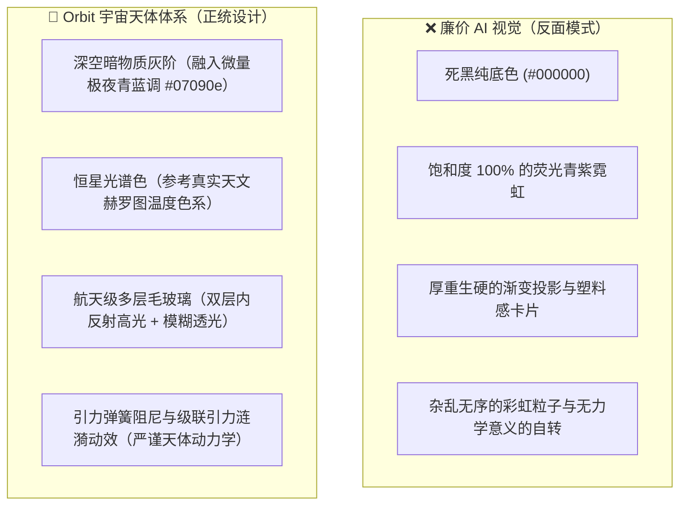
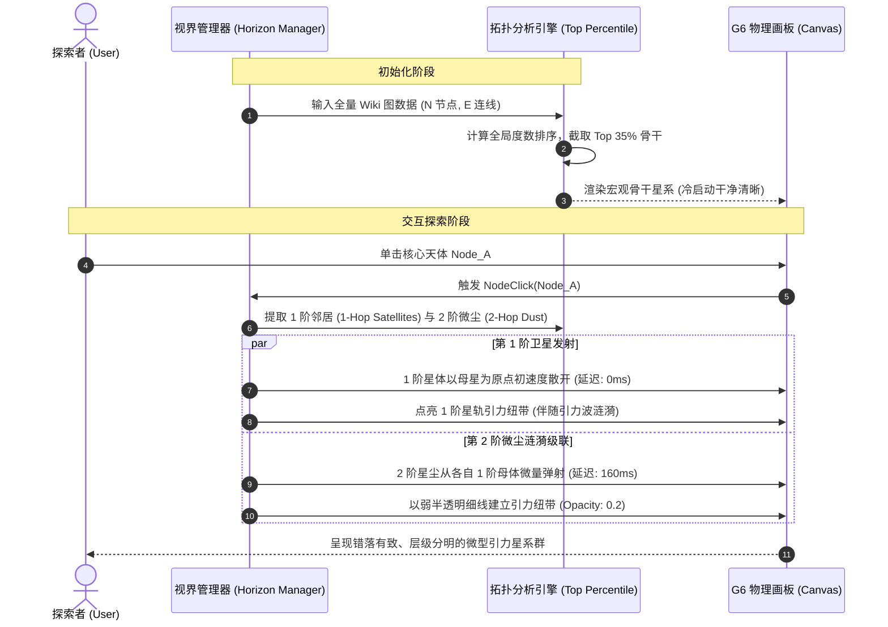

# Orbit 宇宙星空视觉系统与前端配色规范 (Cosmic Design & Color System)

> **设计哲学**: 宇宙深空、天体物理、非廉价 AI 质感、极致航天 HUD 毛玻璃、天体物理引力动效  
> **适用领域**: Orbit 知识引力网络界面、G6 节点/边着色器、悬浮控制台与交互状态机

---

## 1. 宇宙视觉哲学：为何必须摒弃“廉价 AI 味”？

在过去几年的生成式 AI 产品中，大量充斥着高饱和青色（Cyan `#00FFFF`）拼合高亮洋红（Magenta `#FF00FF`）的渐变边框，以及无节制的多彩霓虹粒子，这导致了严重的视觉疲劳与“廉价算法玩具感”。

Orbit 追求的是**真实深空天体物理（Astrophysics & Deep Space Observation）**的高级沉浸感：



---

## 2. 宇宙调色板与设计令牌 (Cosmic Design Tokens)

### 2.1 深空暗物质底座（Deep Space & Dark Matter）

宇宙空间不是空无一物的“纯黑”，而是充满微弱宇宙微波背景、引力场与暗物质的深邃层次：

```css
:root {
  /* 宇宙空间极深基底 */
  --space-void: #06070a;          /* 最底层虚空黑，微泛极深蓝灰 */
  --space-backdrop: #0a0c13;      /* 主视口底色，深邃稳重 */
  --space-surface: #111420;       /* 毛玻璃底板背光色 */
  --space-surface-elevated: #171b2c; /* 悬浮卡片高亮底色 */

  /* 引力场与网格微弱反射 */
  --space-grid: rgba(255, 255, 255, 0.025);
  --space-grid-subtle: rgba(148, 163, 184, 0.04);
}
```

---

### 2.2 恒星能量核心谱系（Stellar Spectral Classes）

放弃随机花哨的颜色，节点颜色严格映射**天文恒星赫罗图（H-R Diagram）温度能量分布**：

| 天体类型 | 代表色系 | 核心色 (Core) | 光晕色 (Halo) | 知识隐喻领域 |
| :--- | :--- | :--- | :--- | :--- |
| **超新星 / 脉冲中子星** | 极高能量蓝冷光 | `#38bdf8` (Sky) | `rgba(56, 189, 248, 0.28)` | 核心系统、底层基建、高频高质节点 |
| **主序星 / 恒星核心** | 稳态紫罗兰冷辉 | `#818cf8` (Indigo) | `rgba(129, 140, 248, 0.24)` | 标准领域知识、核心架构体系 |
| **原恒星 / 活跃星云** | 翠色星云电离光 | `#34d399` (Emerald) | `rgba(52, 211, 153, 0.25)` | 正在持续迭代演化的新知识、活跃专题 |
| **黄矮星 / 稳定引力源** | 琥珀金核 | `#fbbf24` (Amber) | `rgba(251, 191, 36, 0.22)` | 经过验证的归档沉淀、数据库、经典范式 |
| **跨星系中继 / 虫洞枢纽** | 引力红移暗玫瑰 | `#fb7185` (Rose) | `rgba(251, 113, 133, 0.32)` | 跨学科核心桥梁（Betweenness 极高节点） |
| **微星星尘 (Satellites)** | 苍白冷白星屑 | `#cbd5e1` (Slate) | `rgba(203, 213, 225, 0.12)` | 1 阶 / 2 阶边缘小微笔记碎片 |

---

### 2.3 宇宙引力丝状纽带（Gravitational Filament Tokens）

知识连线如同宇宙星际丝状结构（Cosmic Web），必须细致且通透：

```css
:root {
  /* 常态未激活星轨纽带 */
  --filament-idle: rgba(148, 163, 184, 0.18);
  --filament-idle-width: 1px;

  /* 骨干主干航道纽带 */
  --filament-backbone: rgba(129, 140, 248, 0.35);
  --filament-backbone-width: 1.5px;

  /* 激发态引力星流（带能量流动感） */
  --filament-active: #67e8f9;
  --filament-active-glow: rgba(103, 232, 249, 0.45);
  --filament-active-width: 2.5px;

  /* 2 阶微弱引力线 */
  --filament-secondary: rgba(148, 163, 184, 0.08);
}
```

---

## 3. 航天毛玻璃与悬浮空间体系 (Cosmic Glassmorphism)

为了营造宇航员观察窗（Observatory HUD）的现代科技感，所有浮窗、工具栏与卡片采用**多层物理散射毛玻璃**配方。

### 3.1 毛玻璃标准配方（Glass Recipe）

```css
/* 宇宙观察窗 HUD 通用玻璃基类 */
.cosmic-glass {
  background: rgba(13, 16, 26, 0.65);
  backdrop-filter: blur(20px) saturate(180%);
  -webkit-backdrop-filter: blur(20px) saturate(180%);
  
  /* 精确的微光边缘反射：上边亮、下边暗，模拟顶部微弱星光 */
  border: 1px solid rgba(255, 255, 255, 0.08);
  border-top-color: rgba(255, 255, 255, 0.16);
  border-bottom-color: rgba(255, 255, 255, 0.03);

  /* 多层深度阴影：内部泛光 + 外部景深漫射 */
  box-shadow: 
    inset 0 1px 0 0 rgba(255, 255, 255, 0.1),
    0 12px 36px -4px rgba(0, 0, 0, 0.55),
    0 4px 16px -2px rgba(0, 0, 0, 0.35);
  border-radius: 14px;
}

/* 交互悬浮高亮态 */
.cosmic-glass-hover {
  transition: all 0.3s cubic-bezier(0.16, 1, 0.3, 1);
}
.cosmic-glass-hover:hover {
  background: rgba(19, 23, 38, 0.75);
  border-color: rgba(255, 255, 255, 0.18);
  transform: translateY(-2px);
  box-shadow: 
    inset 0 1px 0 0 rgba(255, 255, 255, 0.15),
    0 20px 48px -6px rgba(0, 0, 0, 0.65),
    0 0 20px rgba(56, 189, 248, 0.12);
}
```

---

### 3.2 空间层级（Spatial Elevation Matrix）

```text
Z-Index 400: [Modal / Lightbox]      视界全景大图、重大告警
Z-Index 300: [Inspector Panel]       右侧天体详情卡片、多阶拓扑透镜 (HUD Detail)
Z-Index 200: [Floating Controls]     顶部/底部控制台、视口缩放悬浮按钮
Z-Index 100: [HUD Legends & Stats]   图例面板、实时节点数/星团指标统计
Z-Index 1:   [Canvas Viewport]       G6 画布核心渲染层（天体、星轨、流光）
Z-Index 0:   [Deep Void Mesh]        宇宙深空暗微粒网格底图
```

---

## 4. 天体动力学动效体系 (Celestial Kinetics)

### 4.1 物理缓动曲线（Easing Curves）

严禁使用生硬的 `linear` 或标准 `ease-in-out`。宇宙天体具有质量惯性与引力阻尼：

```css
:root {
  /* 引力弹簧阻尼：适用于星体弹射展开、卡片悬浮、面板进出 */
  --ease-gravity: cubic-bezier(0.16, 1, 0.3, 1);

  /* 能量脉冲曲线：适用于引力波爆发、激活高亮 */
  --ease-pulse: cubic-bezier(0.34, 1.56, 0.64, 1);

  /* 坍缩与淡出：平滑收敛，没有回弹 */
  --ease-collapse: cubic-bezier(0.4, 0, 0.2, 1);
}
```

---

### 4.2 恒星呼吸循环（Stellar Luminous Oscillation）

所有核心主序星与超新星保持缓慢低频的引力波呼吸动效，体现“星图是活的”：

```css
@keyframes starBreathe {
  0%, 100% {
    transform: scale(1);
    filter: drop-shadow(0 0 12px var(--halo-glow));
    opacity: 0.95;
  }
  50% {
    transform: scale(1.04);
    filter: drop-shadow(0 0 24px var(--halo-glow-intense));
    opacity: 1;
  }
}
```

---

## 5. Top 百分点截取与 2 阶级联引力扩散算法

用户核心业务逻辑：**“按照 Top 百分点默认只显示宏观骨干；点击支持 2 阶引力涟漪扩散。”**



### 5.1 核心度量与 Top 百分点算法实现

```typescript
export interface NodeDegreeInfo {
  id: string;
  degree: number;
}

/**
 * 按照百分位数计算度数截止阈值 (Percentile Cutoff)
 * @param allNodes 全量节点列表
 * @param allEdges 全量边列表
 * @param topRatio 默认骨干占比，例如 0.35 表示保留度数前 35% 的节点
 */
export function calculateBackboneCutoff(
  allNodes: { id: string }[],
  allEdges: { source: string; target: string }[],
  topRatio = 0.35
): { cutoffDegree: number; degreeMap: Map<string, number> } {
  const degreeMap = new Map<string, number>();

  // 1. 统计每个节点的总度数
  allNodes.forEach(n => degreeMap.set(n.id, 0));
  allEdges.forEach(e => {
    degreeMap.set(e.source, (degreeMap.get(e.source) || 0) + 1);
    degreeMap.set(e.target, (degreeMap.get(e.target) || 0) + 1);
  });

  // 2. 降序排序
  const sortedDegrees = Array.from(degreeMap.values()).sort((a, b) => b - a);
  if (sortedDegrees.length === 0) return { cutoffDegree: 0, degreeMap };

  // 3. 计算截止阈值
  const cutoffIndex = Math.min(
    sortedDegrees.length - 1,
    Math.max(0, Math.floor(sortedDegrees.length * topRatio))
  );
  const cutoffDegree = Math.max(2, sortedDegrees[cutoffIndex]);

  return { cutoffDegree, degreeMap };
}
```

---

### 5.2 2 阶引力级联扩散算法 (2-Hop Ripple Expansion)

在 2 阶扩散中，**必须保证物理特征衰减**：
- **1 阶节点（1-Hop）**：主卫星星体，尺寸为母星的 $60\%\sim 70\%$，连线清晰亮眼。
- **2 阶节点（2-Hop）**：边缘微星星尘，尺寸为母星的 $35\%\sim 45\%$，无强烈 Halo，引力线半透明细弱。

```typescript
export interface HopExpansionResult {
  hop1Nodes: string[];
  hop2Nodes: string[];
  edgesToActivate: { source: string; target: string; hopLevel: 1 | 2 }[];
}

/**
 * 计算以 centerNodeId 为中心的 2 阶邻域
 */
export function computeTwoHopNeighborhood(
  centerNodeId: string,
  allEdges: { source: string; target: string }[]
): HopExpansionResult {
  const hop1Set = new Set<string>();
  const hop2Set = new Set<string>();
  const edgesToActivate: { source: string; target: string; hopLevel: 1 | 2 }[] = [];

  // 1. 检索 1 阶邻居
  allEdges.forEach(edge => {
    if (edge.source === centerNodeId && edge.target !== centerNodeId) {
      hop1Set.add(edge.target);
      edgesToActivate.push({ source: edge.source, target: edge.target, hopLevel: 1 });
    } else if (edge.target === centerNodeId && edge.source !== centerNodeId) {
      hop1Set.add(edge.source);
      edgesToActivate.push({ source: edge.source, target: edge.target, hopLevel: 1 });
    }
  });

  // 2. 检索 2 阶邻居（排除母星和自身已是 1 阶的节点）
  allEdges.forEach(edge => {
    const sInHop1 = hop1Set.has(edge.source);
    const tInHop1 = hop1Set.has(edge.target);

    if (sInHop1 && !hop1Set.has(edge.target) && edge.target !== centerNodeId) {
      hop2Set.add(edge.target);
      edgesToActivate.push({ source: edge.source, target: edge.target, hopLevel: 2 });
    } else if (tInHop1 && !hop1Set.has(edge.source) && edge.source !== centerNodeId) {
      hop2Set.add(edge.source);
      edgesToActivate.push({ source: edge.source, target: edge.target, hopLevel: 2 });
    }
  });

  return {
    hop1Nodes: Array.from(hop1Set),
    hop2Nodes: Array.from(hop2Set),
    edgesToActivate,
  };
}
```

---

## 6. 前端 UI 组件毛玻璃落地模板 (Vue 3 SFC)

以下为符合本规范的观测站 HUD 工具栏与悬浮详情组件实现模板：

```vue
<template>
  <aside class="cosmic-hud-panel cosmic-glass">
    <div class="hud-header">
      <div class="hud-indicator" :style="{ backgroundColor: statusColor }"></div>
      <span class="hud-title">天体视界探测仪 (DEEP SPACE HUD)</span>
      <span class="hud-badge">{{ activeMode }}</span>
    </div>

    <div class="hud-body">
      <div class="stat-grid">
        <div class="stat-card">
          <span class="label">宏观骨干截取</span>
          <span class="value">TOP {{ (topRatio * 100).toFixed(0) }}%</span>
        </div>
        <div class="stat-card">
          <span class="label">扩散深度</span>
          <span class="value">2-HOP (二阶涟漪)</span>
        </div>
      </div>
    </div>
  </aside>
</template>

<style scoped>
.cosmic-hud-panel {
  padding: 16px 20px;
  min-width: 320px;
  position: absolute;
  top: 20px;
  left: 20px;
  z-index: 200;
}

.hud-header {
  display: flex;
  align-items: center;
  gap: 10px;
  margin-bottom: 14px;
}

.hud-indicator {
  width: 8px;
  height: 8px;
  border-radius: 50%;
  box-shadow: 0 0 10px currentColor;
  animation: starBreathe 3s infinite var(--ease-gravity);
}

.hud-title {
  font-size: 13px;
  font-weight: 700;
  letter-spacing: 0.8px;
  color: #f1f5f9;
  text-transform: uppercase;
}

.hud-badge {
  margin-left: auto;
  font-size: 11px;
  padding: 2px 8px;
  border-radius: 20px;
  background: rgba(56, 189, 248, 0.15);
  color: #38bdf8;
  border: 1px solid rgba(56, 189, 248, 0.3);
}

.stat-grid {
  display: grid;
  grid-template-columns: 1fr 1fr;
  gap: 10px;
}

.stat-card {
  background: rgba(255, 255, 255, 0.03);
  padding: 10px 12px;
  border-radius: 8px;
  border: 1px solid rgba(255, 255, 255, 0.05);
}

.label {
  display: block;
  font-size: 11px;
  color: #94a3b8;
  margin-bottom: 4px;
}

.value {
  font-size: 14px;
  font-weight: 700;
  color: #f8fafc;
  font-family: monospace;
}
</style>
```

---

## 7. 质量验收准则 (Cosmic UX Quality Checklist)

- [ ] **视觉质感**：背景无死黑与刺眼强霓虹，毛玻璃具备清晰的双层内反射线与环境景深。
- [ ] **骨干清晰度**：冷启动时仅渲染 Top 百分位骨干天体，画面整洁有聚散结构，无杂乱噪点。
- [ ] **2 阶扩散物理感**：1 阶卫星与 2 阶微尘具备时间阶梯差（120~180ms），散开轨迹呈现引力阻尼减速。
- [ ] **交互收敛**：再次点击母星或空白区域能平滑坍缩收回，力导向算法在节点稳定后自动挂起（Freeze/Decay）。
