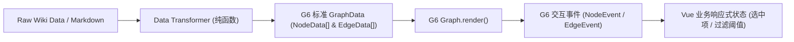

# Orbit 前端工程化开发规范 (Frontend Engineering Standards)

> **适用范围**: Orbit 宇宙引力知识图谱项目及相关前端子系统  
> **核心原则**: 模块解耦、强类型约束、高性能可视化、规范化交付

---

## 1. 工程化概述与技术栈架构

### 1.1 技术栈基石与选型矩阵

| 分类 | 选型 | 版本/规范 | 选型意图与工程定位 |
| :--- | :--- | :--- | :--- |
| **基础框架** | Vue 3 | `^3.5.x` | 采用组合式 API (`<script setup>`)，具备极佳的逻辑复用与 TypeScript 推导。 |
| **构建工具** | Vite | `^8.x` | ESM 原生开发伺服，极速冷启动与 HMR；集成 Rolldown 高性能打包能力。 |
| **语言规范** | TypeScript | `~6.x` | 全量静态类型检查，消除隐式 `any`，通过 AST 与类型体操保障数据结构安全。 |
| **图可视化引擎** | AntV G6 | `^5.1.x` | 基于 Canvas/WebGL 混合管线的下一代图引擎，具备原生物理力导向与自适应视口。 |
| **包管理器** | pnpm | `^10.x` | 硬链接 + 符号链接拓扑，严格防幻影依赖（Phantom Dependencies），复用缓存。 |

---

### 1.2 目录分层架构（Directory Topology）

项目严格遵循单向依赖流，禁止跨层级反向耦合：

```text
orbit/
├── .vscode/                   # 团队统一 IDE 配置与推荐插件
├── docs/                      # 架构设计与工程规范文档
│   ├── dev/                   # 开发者指南与技术标准
│   └── wiki/                  # 业务知识与元数据定义
├── public/                    # 纯静态资源（不经打包工具处理）
├── src/
│   ├── assets/                # 全局静态资源（图片、SVG 图标、全局字体）
│   ├── components/            # Vue 组件层
│   │   ├── common/            # 通用原子 UI 组件（按钮、卡片、模态窗等）
│   │   ├── layout/            # 布局骨架组件（Header、Sidebar、CanvasWrapper）
│   │   └── graph/             # 图可视化领域专用组件（Canvas、Toolbar、Minimap）
│   ├── composables/           # 组合式函数业务逻辑层（Stateful Hooks）
│   │   ├── useCelestialLayout.ts # 拓扑算法与力导向物理控制
│   │   └── useHorizon.ts         # 视界探索与动态展开状态机
│   ├── types/                 # 全局强类型定义（.d.ts & 业务契约）
│   │   ├── celestial.ts       # 星体、星轨、天体度量等核心模型
│   │   └── graph.ts           # G6 适配类型与事件 Payload
│   ├── utils/                 # 无状态纯函数工具集（Pure Utility Functions）
│   │   ├── celestial-math.ts  # 对数半径映射、Halo 梯度计算、力学常量
│   │   └── format.ts          # 字符串、日期与数字格式化
│   ├── styles/                # 样式与设计令牌体系
│   │   ├── tokens.css         # CSS 变量、宇宙暗色系配色令牌
│   │   └── reset.css          # 跨浏览器盒模型统一
│   ├── App.vue                # 根应用视图
│   ├── main.ts                # 应用启动入口
│   └── vite-env.d.ts          # Vite 客户端环境类型声明
├── index.html                 # 单页 HTML 宿主模板
├── package.json               # 项目元数据与依赖定义
├── tsconfig.json              # 顶层 TypeScript 聚合配置
├── tsconfig.app.json          # 业务源码 TypeScript 编译规则
└── vite.config.ts             # Vite 构建与路径别名配置文件
```

---

## 2. TypeScript 编码与类型工程规范

### 2.1 强类型原则与约束

1. **零 `any` 容忍**：严禁显式或隐式出现 `any`。遇到动态三方库结构，必须使用 `unknown` 并配合自定义类型守卫（Type Guard）或 `as` 窄化。
2. **精准的可选字段**：明确区分 `field?: T`（可选字段）与 `field: T | null`（必须存在但可为空）。
3. **不可变性优先**：对于纯配置与状态常量，使用 `as const` 或 `Readonly<T>` 保证引用安全。

```typescript
// ✅ 正确：定义明确契约，搭配只读与枚举约束
export interface CelestialBody {
  readonly id: string;
  name: string;
  mass: number;
  clusterId: string;
  stage: 'nebula' | 'main-sequence' | 'black-hole';
  haloAlpha: number;
}

// ❌ 错误：滥用 any 与弱类型
export interface BadBody {
  id: any;
  options: Object; // 永远不要使用小写或大写 Object
  [key: string]: any;
}
```

### 2.2 路径别名（Path Alias）使用规范

- 项目全局配置 `@/` 指向 `/src/`。
- **强制使用** `@/` 导入跨目录模块，避免出现超过两层的相对路径（如 `../../../../utils/math`）。
- 同级目录组件或相邻工具可使用 `./`。

```typescript
// ✅ 推荐
import { computeRadius } from '@/utils/celestial-math';
import type { CelestialNodeData } from '@/types/celestial';

// ❌ 禁止
import { computeRadius } from '../../../utils/celestial-math';
```

---

## 3. Vue 3 核心组件架构与状态规范

### 3.1 `<script setup lang="ts">` 组合式标准

所有 Vue 组件一律采用单文件组件（SFC）与 `<script setup lang="ts">` 语法：

```vue
<script setup lang="ts">
import { computed } from 'vue';
import type { CelestialMetrics } from '@/types/celestial';

// 1. Props 强类型声明（推荐基于类型的声明模式）
interface Props {
  nodeId: string;
  metrics: CelestialMetrics;
  isActive?: boolean;
}

const props = withDefaults(defineProps<Props>(), {
  isActive: false,
});

// 2. Emits 强类型声明
interface Emits {
  (e: 'select', nodeId: string): void;
  (e: 'pulse', nodeId: string, energy: number): void;
}

const emit = defineEmits<Emits>();

// 3. 派生计算属性
const displaySize = computed(() => `${props.metrics.size}px`);

// 4. 事件触发处理
const handleTrigger = () => {
  emit('select', props.nodeId);
};
</script>
```

### 3.2 响应式陷阱防范：G6 实例的“浅引用”法则

> [!CAUTION]
> **切勿对 AntV G6 的 `Graph` 实例使用 `ref()` 或 `reactive()`！**  
> G6 内部包含海量底层 Canvas、WebGL 节点树、事件发射器与渲染循环。若使用 Vue 的 Deep Proxy 代理，会导致：
> 1. 递归监听巨大对象树，造成严重的性能衰退与内存暴涨；
> 2. 内部 `this` 指向被代理篡改，导致事件触发失效与渲染崩溃。

```typescript
// ✅ 正确做法 1：使用普通变量存储实例，配合 onMounted / onBeforeUnmount
let graphInstance: Graph | null = null;

// ✅ 正确做法 2：若必须在 Vue 上下文中共享，必须使用 shallowRef
import { shallowRef } from 'vue';
const graphRef = shallowRef<Graph | null>(null);

onBeforeUnmount(() => {
  // 必须显式注销与销毁，防止内存泄漏
  if (graphInstance) {
    graphInstance.destroy();
    graphInstance = null;
  }
});
```

---

## 4. AntV G6 图可视化工程实践规范

### 4.1 数据流架构：单向流与纯数据转换

图可视化组件的数据流向必须清晰规范，避免直接就地修改图数据源：



### 4.2 性能治理基线（Performance Budget）

1. **自适应尺寸与防抖**：开启 G6 内置 `autoResize: true`。若监听外部容器变更，需使用 `ResizeObserver` 并加入 `requestAnimationFrame` 防抖。
2. **物理力导向降频（Force Layout Tick）**：对于大规模星图（节点数 > 500），力导向模拟必须设置衰减阈值（`alphaMin: 0.001`，`alphaDecay: 0.05`），在星团聚拢稳定后自动停止计算，释放 CPU 占用。
3. **视口外元素渲染剔除**：在视口剧烈平移与缩放时，使用 Lod 机制隐藏低阶星尘节点的文本标签（Label），只保留星核像素点。

---

## 5. 样式体系与深空设计令牌 (Design Tokens)

### 5.1 CSS 变量令牌化规范

在 `src/styles/tokens.css` 中声明宇宙星系核心设计系统，所有样式必须引用语义化 Token，禁止在组件中硬编码十六进制颜色值。

```css
:root {
  /* 深空暗黑背景基准 */
  --space-bg-deep: #08090d;
  --space-bg-surface: #10121a;
  --space-bg-overlay: rgba(22, 25, 37, 0.75);
  
  /* 引力与星光主题色谱 */
  --star-core-blue: #38bdf8;
  --star-core-violet: #a855f7;
  --star-core-emerald: #34d399;
  --star-core-amber: #fbbf24;
  --star-core-crimson: #f43f5e;
  
  /* 引力纽带与网格 */
  --filament-line: rgba(148, 163, 184, 0.22);
  --filament-active: #818cf8;
  --gravity-grid: rgba(255, 255, 255, 0.03);

  /* 文字语义分层 */
  --text-primary: #f8fafc;
  --text-secondary: #94a3b8;
  --text-muted: #64748b;
  
  /* 动效缓动曲线 */
  --ease-cosmic: cubic-bezier(0.16, 1, 0.3, 1);
}
```

### 5.2 组件样式的隔离与命名

- 强制在 `<style scoped>` 下编写组件样式，杜绝全局污染。
- 遵循简化 BEM 语义命名：`.block__element--modifier`。

---

## 6. Git 协作与提交信息规范 (Conventional Commits)

团队严格遵循 **Conventional Commits 1.0.0** 规范，提交格式如下：

```text
<type>(<scope>): <subject>

[optional body]

[optional footer(s)]
```

### 6.1 Type 分类标准

| Type | 语义说明 | 范例 |
| :--- | :--- | :--- |
| `feat` | 新增功能特性 | `feat(graph): 引入视界展开多阶弹射算法` |
| `fix` | 修复缺陷与 Bug | `fix(layout): 修复力导向衰减未停止导致的 CPU 占用过高` |
| `perf` | 性能提升与优化 | `perf(render): 对低度数星尘节点应用 LOD 文本裁剪` |
| `refactor` | 代码重构（不改变功能与表现） | `refactor(math): 重构度数对数归一化纯函数` |
| `style` | 样式、排版与视觉 Token 调整 | `style(tokens): 调整深空暗色系高对比度发光色` |
| `docs` | 文档新增或更新 | `docs(spec): 补充天体引力动力学推导公式` |
| `chore` | 构建配置、依赖升级或工具链杂务 | `chore(deps): 升级 @antv/g6 至 5.1.1` |

---

## 7. 构建与打包优化规范 (Build & Bundling)

### 7.1 分包策略（Chunk Splitting）

由于 AntV G6 及其数学布局引擎体积较大，Vite 打包配置中需通过 `build.rollupOptions.output.manualChunks` 将三方库与业务逻辑分包：

```typescript
// vite.config.ts 推荐打包优化片段
export default defineConfig({
  build: {
    target: 'esnext',
    chunkSizeWarningLimit: 1200,
    rollupOptions: {
      output: {
        manualChunks: {
          'vendor-vue': ['vue'],
          'vendor-antv-g6': ['@antv/g6'],
        },
      },
    },
  },
});
```

---

## 8. 代码审查清单 (PR Checklist)

开发者在提交 Pull Request 前，必须自测并通过以下清单：

- [ ] **编译测试**：执行 `pnpm run build` 成功通过，无 TypeScript 报错及 TS5101 等废弃告警。
- [ ] **内存检查**：所有新建 G6 实例及原生事件监听在 `onBeforeUnmount` 中已完整释放。
- [ ] **响应式安全**：未将 G6 实例或复杂物理引擎对象置入 `ref()` 或 `reactive()`。
- [ ] **设计还原**：页面暗色主题色调符合 Design Tokens 规范，适配各种分辨率屏幕。
- [ ] **提交规范**：Git Commit 记录清晰且遵循 Conventional Commits 格式。
